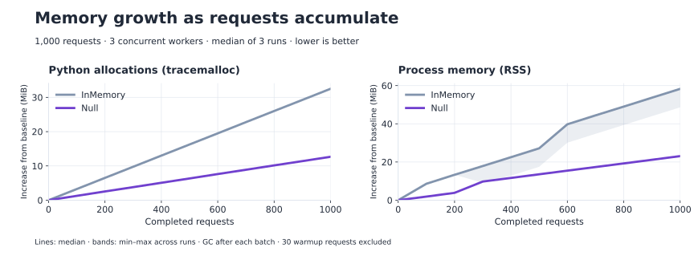

# A2A receiver memory benchmark

`a2a_basic` のリモート素数判定エージェントへ HTTP / A2A JSON-RPC の
`message/send` を送り、`InMemorySessionService` と `NullSessionService` の
**処理完了・GC後に残るメモリの増分**を比較する。外部LLMやAPIキーは不要。

## 実測結果（2026-11-18）

RSS用とPython追跡量用は、**独立したサーバープロセス**で測定する。
RSS用ではtracemallocを無効にし、トレーサーの管理メモリをRSSに含めない。
標準の1000回・並列数3・各3反復を、両モード・両サービスの計12プロセスで実行した。

<picture>
  <source media="(prefers-color-scheme: dark)" srcset="assets/memory-comparison-dark.svg">
  
</picture>

棒は3反復の中央値、ひげは最小〜最大。ウォームアップ後の基準値からの増分で、
小さいほど処理後に残るメモリが少ない。左右のパネルでは横軸の目盛りが異なる。

**この条件での増分は、RSSで約61%、Python追跡量で約61%小さかった。**
macOS / arm64、Python 3.13.18、ADK 2.13.0、A2A SDK 0.3.26で測定。
全12000件の計測リクエストが成功し、全120バッチで最大同時数3を確認した。

| 1000回後の増分（3反復の中央値） | InMemory | Null |
| --- | ---: | ---: |
| RSS（tracemalloc無効） | 34.17 MiB | 13.42 MiB |
| Python追跡量（別プロセス） | 32.52 MiB | 12.66 MiB |
| 保持セッション数 | 1000 | 0 |
| 保持イベント数 | 4000 | 0 |
| 保持A2Aタスク数 | 1000 | 1000 |

<picture>
  <source media="(prefers-color-scheme: dark)" srcset="assets/memory-growth-dark.svg">
  
</picture>

A2Aタスクは両条件で保持しているため、**Null側もメモリ使用量は増加する**。
この結果は、固定LLMを使った、この実行環境・ワークロードでの比較。

元データは [samples.csv](data/2026-11-18/samples.csv)、バージョン・出典ハッシュ・
各反復の結果は [report.json](data/2026-11-18/report.json) に同梱している。
公開データは `benchmark.publish` で自動生成し、測定値を変更せずにパスとPIDを正規化する。

## 実行

リポジトリのルートで専用環境を作る。

```sh
python3.13 -m venv .venv
source .venv/bin/activate
python -m pip install -e '.[benchmark]' 'google-adk==2.13.0' 'a2a-sdk[http-server]==0.3.26'
```

公式ADKのサンプルを、測定に使用した固定コミットから取得する。
次の手順は初回のみ必要。取得先の `.samples/` はGit管理対象外。

```sh
git init benchmark/.samples/adk-python
git -C benchmark/.samples/adk-python remote add origin https://github.com/google/adk-python.git
git -C benchmark/.samples/adk-python fetch --depth 1 origin 1cb926d5b8d702261ec82a26d3f1c4296e0db7d7
git -C benchmark/.samples/adk-python checkout --detach FETCH_HEAD
python -m benchmark.run
```

標準は **1000回・並列数3・各条件3反復・両測定モード**。
サンプルの `agent.py` と隣の `agent.json` を読み込む。インストール済みADKを使い、
取得したチェックアウトのADKソースは `PYTHONPATH` に追加しない。
既存のサンプルを使う場合は `--sample-agent /path/to/check_prime_agent/agent.py` を指定する。
個人のホームディレクトリに依存する初期値は使わない。

```sh
# 小規模な動作確認（端数バッチあり）
python -m benchmark.run --requests 7 --sample-every 3 --warmup 3 --repeats 2

# 並列数2、または直列で比較
python -m benchmark.run --concurrency 2
python -m benchmark.run --concurrency 1

# 片方の測定だけ実行することも可能
python -m benchmark.run --measurement rss
python -m benchmark.run --measurement tracemalloc
```

`--requests` と `--sample-every` は並列数以上にする。最終バッチが並列数より小さい場合は、
そのバッチの件数を期待最大同時数として検証する。比較グラフの生成には両モードが必要。

## 比較条件と測定の順序

- クライアントと受信サーバーは別プロセス。受信側はloopbackの空きポートを使う。
  サービス・モード・反復ごとに新しいサーバープロセスを起動する。
- `rss` モードではtracemallocを無効にする。`tracemalloc` モードでは同じ処理を
  追跡付きで実行し、追跡割り当て量・ピーク・トレーサー自身の管理量を記録する。
  後者のRSSも診断用に記録するが、RSSのグラフや中央値には使わない。
- サンプルの `root_agent` のモデルだけを固定応答に置き換える。
  `check_prime([2, 17, 18])` のツール要求と結果を返す2段階のモデル応答で、
  実際の関数ツール・Runner・A2A executor・JSON-RPC handlerを通す。
  モデルは要求や応答を蓄積しない。
- 入力はすべて `Check whether 2, 17 and 18 are prime.`。
  毎回独立したmessage IDを使い、`contextId` / `taskId` を送らない。
  全応答の完了状態と、サンプル関数を直接呼んだ結果との一致を検証する。
- モデルの各ステップに5 msの非同期待機を設ける。バッチごとの最大同時数が
  `min(並列数, バッチ件数)` と一致することを検証する。
  最大同時数は「バッチの間ずっとその並列度を維持した」ことを意味しない。
- 各条件で30回ウォームアップして基準値を取る。ウォームアップ分のストアも保持したまま、
  基準値からの増分を比較する。モードとサービスの実行順は反復ごとに入れ替える。
- 100回ごとにクライアントの全応答を待ち、受信ミドルウェアの完了を
  `asyncio.Event` とタイムアウトで待つ。固定時間の待機には依存しない。
- 受信側がアイドルになったらGCを実行し、**メモリ採取→ストア件数集計→バッチカウンタ取得**
  の順に処理する。基準値の直前に追跡量のピークをリセットする。
- `InMemoryTaskStore` は両サービスで同じ設定を使い、完了タスクを削除しない。
  OpenTelemetry SDKとサーバーログは無効にする。

これはGC後の保持量を比べる実験であり、連続負荷中のピークRSSや本番のスループットを
評価するものではない。バッチ境界ではトラフィックが止まり、`elapsed_seconds` にも
各バッチ末尾の並列度低下が含まれる。

## 出力の読み方

保存先は `benchmark/results/<実行日時>/`（Git管理対象外）。
`--output /path/to/new-directory` で新しい保存先を指定できる。

| 項目 | 内容 |
| --- | --- |
| `samples.csv` | 基準値とバッチごとの採取値。失敗時も採取済みの行は残る |
| `report.json` | 成否、設定、バージョン、ソース・サンプルの出典とSHA-256、各反復の結果、モード別中央値 |
| `measurement_mode` / `tracemalloc_enabled` | 測定モードと受信側で実際に追跡が有効だったか |
| `rss_bytes` | 現在の受信プロセスRSS。ピークRSSではない |
| `traced_current_bytes` | GC後に追跡している現在の割り当て量。RSS専用モードでは空欄 / null |
| `traced_peak_bytes` | ウォームアップ後にリセットした追跡割り当て量のピーク。RSS専用モードでは空欄 / null |
| `tracemalloc_overhead_bytes` | `get_tracemalloc_memory()` によるトレーサーの管理量。RSS専用モードでは空欄 / null |
| `sessions`, `events`, `tasks` | ストアの保持件数。ウォームアップ分を含む |
| `completed` / `batch_completed` | 計測開始以降の完了数 / 今回のバッチの完了数 |
| `batch_max_active` | 今回のバッチの最大同時数。採取後にリセットする |
| `max_active_since_baseline` | 計測開始以降の最大同時数。累積値であることを区別する |
| `delta_*` | 同じプロセスの基準値の同名項目からの差。そのモードで集計する項目だけ記録する |
| `elapsed_seconds` | HTTP要求実行時間の累積。起動・採取・GCの時間は除く |

RSSにはPython以外の割り当てや予約領域も含まれ、解放・再利用・OSのページの扱いなどに
よって段差や減少が起こり得る。今回の段差の原因を特定したものではない。
RSSと追跡量は独立したプロセスの値なので、その差をトレーサーの管理量とは解釈しない。

両サービスの追加タスク数は要求数と同じで、追加セッション数はInMemory側が要求数、
Null側が0であることも検証する。回数やペイロード・TaskStoreの設定が変われば削減率も
変わる。この実験だけで実LLM、会話継続、長時間運用での一般的な削減率は評価しない。

## 公開データとグラフの再生成

測定時に出典情報を自動記録する。生データを編集せず、次のコマンドで公開用コピーを作る。
測定値とCSVは保持し、設定のパスとPIDのみ正規化する。公開レポートには元ファイルの
SHA-256と変換内容も記録する。出力先は新しいディレクトリにする。

```sh
python -m benchmark.publish benchmark/results/<実行日時> --output benchmark/data/<日付>
python -m benchmark.plot benchmark/data/<日付>
```

引数なしの `python -m benchmark.plot` は同梱の `data/2026-11-18` を使う。
比較の横棒グラフと推移の折れ線を、ライト・ダーク両テーマで生成する。
`--output /path/to/charts` で生成先を変更できる。

不完全な測定、欠けたバッチ・反復、測定モードの不一致、並列度・保持件数の不整合、
CSVとレポートの不一致は公開・描画前に拒否する。追跡付きRSSを測った
[旧データ](data/2026-11-17/report.json) は履歴として保存しているが、現在のグラフには使わない。
旧形式を新しい形式として読み込むことも拒否する。

## 回帰テスト

```sh
python -m pip install -e '.[dev,benchmark]'
python -m pytest -q
```

完了待ち・タイムアウト、計測順序、モード切り替え、バッチ別並列度、出典記録、
公開時の値の保持、不正データの拒否、偶数反復の集計とグラフの再生成を検証する。
描画のテストはMatplotlibが未インストールならskipする。
