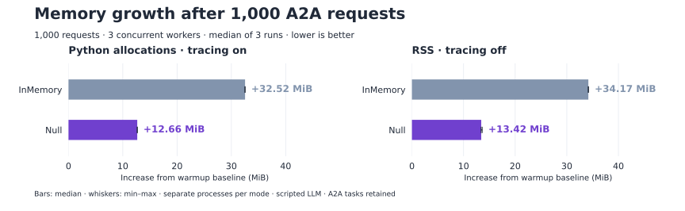

# A2A receiver memory benchmark

`a2a_basic` のリモート素数判定エージェントへ HTTP / A2A JSON-RPC の
`message/send` を送り、`InMemorySessionService` と `NullSessionService` の
**受信サーバーのメモリ増分**を比較する。外部 LLM や API キーは不要。

## 実測結果（2026-11-17）

**1000回・並列数3・各3反復で、Null側のPython追跡メモリの増分は約61%小さかった。**
macOS / arm64、Python 3.13.18、ADK 2.13.0、A2A SDK 0.3.26で測定。
全6000件の応答内容と完了状態を検証し、全6プロセスで最大同時処理数3を確認した。

<picture>
  <source media="(prefers-color-scheme: dark)" srcset="assets/memory-comparison-dark.svg">
  
</picture>

棒は3反復の中央値、ひげは最小〜最大。ウォームアップ後の基準値からの増分で、
小さいほど処理後に残るメモリが少ない。RSSとPython追跡量では横軸の目盛りが異なる。

| 1000回後の増分（3反復の中央値） | InMemory | Null |
| --- | ---: | ---: |
| RSS | 58.28 MiB | 23.08 MiB |
| Pythonの追跡割り当て量 | 32.50 MiB | 12.67 MiB |
| 保持セッション数 | 1000 | 0 |
| 保持イベント数 | 4000 | 0 |
| 保持A2Aタスク数 | 1000 | 1000 |

<picture>
  <source media="(prefers-color-scheme: dark)" srcset="assets/memory-growth-dark.svg">
  
</picture>

線は100回ごとの中央値、帯は最小〜最大。A2Aタスクは両条件で保持しているため、
**Null側もメモリ使用量は増加する**。この結果は固定LLMを使った、この実行環境での比較。

グラフの元データは [samples.csv](data/2026-11-17/samples.csv)、
実行条件とバージョン・各反復の結果は [report.json](data/2026-11-17/report.json) に同梱。
公開用レポートではローカルの絶対パスを相対パスに置き換え、PIDを省略している。
並列数2でも13回・採取間隔6回の動作確認を行い、端数バッチを含む処理と
受信プロセスの正常終了を確認した。

## 実行

リポジトリのルートで、専用の仮想環境へインストールする。

```sh
python3.13 -m venv .venv
source .venv/bin/activate
python -m pip install -e '.[benchmark]' 'google-adk==2.13.0' 'a2a-sdk[http-server]==0.3.26'
python benchmark/run.py
```

デフォルトのサンプル読み込み元は次のローカルファイル。

```text
~/study/reading/adk-python/contributing/samples/a2a/a2a_basic/remote_a2a/check_prime_agent/agent.py
```

別のチェックアウトを使う場合は `--sample-agent /path/to/check_prime_agent/agent.py`
を指定する。同じディレクトリの `agent.json` も必要。
インストールした ADK を使ってサンプルを読み込み、ADK チェックアウトのソースは
`PYTHONPATH` に追加しない。サンプル自体も書き換えない。

標準では **1000回・並列数3・各条件3反復**。各反復で新しい受信プロセスを起動する。
小さく動作確認するには次のように実行する。

```sh
python benchmark/run.py --requests 12 --sample-every 6 --warmup 3 --repeats 1
```

並列数2、またはリクエスト数を増やして実行する例。

```sh
python benchmark/run.py --concurrency 2
python benchmark/run.py --requests 10000 --sample-every 1000
```

## 比較条件

- クライアントと受信サーバーは別プロセス。受信サーバーは loopback の空きポートを使う。
- サンプルの `root_agent` を読み込み、モデルだけを応答固定の `BaseLlm` に置き換える。
  `check_prime([2, 17, 18])` のツール要求と結果を返す2段階のモデル応答を生成し、
  サンプルの本物の関数ツール・Runner・A2A executor・JSON-RPC handler を通す。
  モデルは過去の要求や応答をリストに保持しない。
- 入力はすべて `Check whether 2, 17 and 18 are prime.`。
  毎回独立した message ID を使い、`contextId` / `taskId` を送らない。
  全応答の完了状態と、サンプル関数を直接呼んだ結果との一致を検証する。
- 固定モデルの各ステップに5 msの非同期待機を設け、受信側で実際に並行処理が
  発生するようにする。計測区間の受信処理の最大同時数が2以上かつ設定値以下である
  ことも検証する。これは実LLMのレイテンシやスループットの測定ではない。
- 各条件で30回ウォームアップしてから基準値を取る。ウォームアップ中の
  セッション・タスクも保持したまま、基準値からの増分を比較する。
- 計測中は並列数ぶんのワーカーが次々に送信する。100回ごとに全応答を待って
  受信処理が完了していることを確認し、GC後の値を採取する。
  採取の境界では一度並列処理が止まる。
- `InMemoryTaskStore` は両条件で同じものを使い、完了タスクを削除しない。
  OpenTelemetry SDK とサーバーログは無効。条件の実行順は反復ごとに入れ替える。

## 出力の読み方

既定の保存先は `benchmark/results/<実行日時>/`（Git管理対象外）。
`--output /path/to/new-directory` で新しい保存先を指定できる。

| ファイル / 項目 | 内容 |
| --- | --- |
| `samples.csv` | 基準値と100回ごとの採取値。失敗時も採取済みの行を残す |
| `report.json` | 設定、バージョン、サンプルのSHA-256、各反復の基準値・最終値、増分の中央値、実行成否 |
| `rss_bytes` | 受信プロセスの現在のRSS。ピークRSSではない |
| `traced_current_bytes` | GC後にPythonのトレーサーが追跡する現在の割り当て量 |
| `traced_peak_bytes` | ウォームアップ後にリセットして以降の追跡割り当て量のピーク |
| `sessions`, `events`, `tasks` | 受信側ストアに保持された件数。ウォームアップ分を含む |
| `completed`, `max_active` | 計測区間の完了HTTP要求数と最大同時処理数 |
| `delta_*` | 同じプロセスのウォームアップ後の基準値からの差 |
| `elapsed_seconds` | HTTP要求を実行した時間の累積。採取・GC・起動時間は除く |

`requests` を横軸、`delta_rss_bytes` / `delta_traced_current_bytes` を縦軸にして
サービスごとの増え方を比較する。RSSにはPython以外の割り当てやアロケーターの
予約領域も含まれ、GCでオブジェクトが消えてもすぐに減るとは限らない。
tracemalloc自身の管理領域もRSSに含まれるため、このRSSは計測器を有効にした値。

**Null側もA2Aタスクを保持するため、サーバー全体のメモリが一定になるとは限らない。**
この比較で確かめるのは同じ処理件数でセッション保持を省くことによる増分の差。
セッション数の増分がInMemory側で要求数ぶん、Null側で0、タスク数の増分が
両条件で要求数ぶんになることも実行時に検証する。

1000回で差が小さい場合は回数を増やし、複数反復の結果を確認する。
このベンチマークだけで実LLM、会話継続、長時間の運用や本番負荷での動作は評価しない。

## グラフの再生成

`benchmark` extraにはMatplotlibも含まれる。同梱データからREADME用のSVGを再生成するには、
リポジトリのルートで次を実行する。

```sh
python benchmark/plot.py
```

`assets/` に比較の横棒グラフと推移の折れ線グラフを、ライト・ダーク両テーマで生成する。
新しく測定したデータを描く場合は、結果ディレクトリを指定する。

```sh
python benchmark/plot.py benchmark/results/<実行日時> --output benchmark/results/<実行日時>/charts
```

完走していない測定や反復が欠けたCSV、最終値がレポートと一致しないデータは拒否する。
